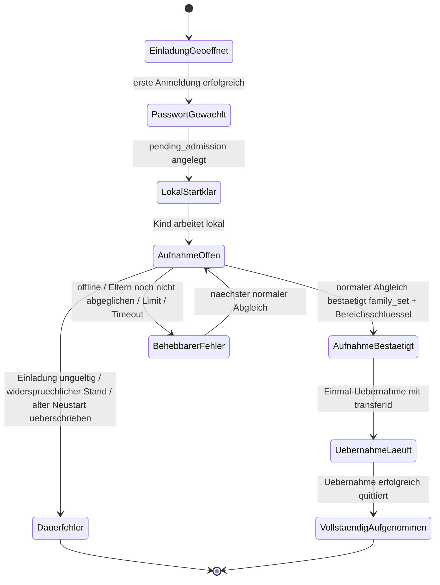

# Konzept - Kindstart ohne Polling

## Version History

| Version | Date       | Author(s) | Summary of Changes |
|:--------|:-----------|:----------|:-------------------|
| 1.0     | 2026-11-08 | OpenCode  | Initial version |

## Executive Summary

Das Kind soll nach Einladung, QR oder Startlink und der ersten Passwortwahl sofort in Big Quest landen, ohne auf ein gleichzeitig aktives Elterngeraet zu warten. Die heutige Wartephase ist kein reines UI-Problem, sondern entsteht erst dadurch, dass `anmKindBereit` den aktuellen Schluessel fuer `kind:lern:<kind>` verlangt und dieser Schluessel erst nach der spaeteren Aufnahme durch ein Elterngeraet vorhanden ist. Empfohlen wird deshalb ein lokaler Sofortstart mit spaeterer, idempotenter Uebernahme: Das Kind darf sofort lokal arbeiten, die Familienaufnahme bleibt unveraendert asynchron, und die ersten Daten werden erst nach bestaetigter Aufnahme genau einmal in den regulaeren Lernbereich uebernommen.

---

## 1. Heutiger Ablauf und technischer Grund der Wartephase

### Heutiger Ablauf

1. Das Kind oeffnet Einladung oder Startlink.
2. `ersteAnmeldung` legt das Kinderkonto und dessen Schluessel an.
3. Das Kindergeraet startet `kontoKindStart` und ruft sofort `kontoAbgleich()` auf.
4. `anmKindBereit` prueft, ob das Kind den aktuellen Schluessel fuer `kind:lern:<kind>` schon lesen kann.
5. Solange das Elterngeraet den Beweis der Einladung noch nicht geprueft, `family_set` noch nicht geschrieben und die Schluessel noch nicht verteilt hat, bleibt die Antwort `false`.
6. Die UI faellt auf `Almost ready!` zurueck und prueft periodisch erneut.

### Kernursache

Der Blocker ist die fachliche Aufnahme in die Familie, nicht nur das Timing der Oberflaeche:

- Das Kind darf heute erst schreiben, wenn es Mitglied des Lernbereichs ist.
- Dieses Mitglied wird heute erst durch das Elterngeraet bestaetigt.
- Vorher entstuenden sonst Eintraege vor der gueltigen Aufnahme oder mit unklarer Schluesselbasis.

Die heutige Polling-Schleife ist also nur der sichtbare Effekt einer spaeteren kryptographischen Aufnahme.

## 2. Zielbild

Der neue Normalfall soll so aussehen:

1. Einladung oeffnen.
2. Passwort waehlen.
3. Sofort in die Kinderansicht wechseln.
4. Erste lokale Uebungen sind erlaubt, auch wenn das Elterngeraet gerade aus ist oder offline bleibt.
5. Die spaetere Aufnahme in Familie und Speicher laeuft ohne gemeinsame Aktivitaet beider Geraete.
6. Erst wenn diese Aufnahme bestaetigt ist, werden die lokalen Anfangsdaten genau einmal in den regulaeren Datenfluss uebernommen.
7. Fehler dieser spaeteren Aufnahme werden zuerst Erwachsenen/Admins gezeigt, nicht dem Kind beim Start.

Wichtig: Es gibt keinen eigenen Warteraum und keine spezielle Polling-Abhaengigkeit mehr zwischen Kind- und Elterngeraet. Erlaubt bleiben nur die ohnehin vorhandenen normalen Abgleichpunkte der App (Start, Wieder sichtbar, manuell, regulare Hintergrundlaeufe).

## 3. Vergleich von Loesungswegen

### Weg A - Lokaler Sofortstart mit spaeterer Uebernahme

#### Idee

Nach der ersten Passwortwahl bekommt das Kind sofort eine normale lokale Kind-Sitzung. Solange die Familienaufnahme noch fehlt, arbeitet die App in einem klar markierten Zustand `pending_admission`.

In diesem Zustand gilt:

- das Kind darf die Kinderansicht benutzen,
- erste Fortschritte werden lokal in einem eigenen Pending-Datensatz gespeichert,
- es werden noch keine regulaeren Schreibvorgaenge in `kind:lern:<kind>` ausgeloest,
- die bekannte Aufnahme ueber `invite_set` -> Beweispruefung -> `family_set` -> Schluesselverteilung bleibt fachlich unveraendert,
- nach bestaetigter Aufnahme laeuft eine idempotente Einmal-Uebernahme der lokalen Pending-Daten in den regulaeren Lernbereich.

#### Vorteile

- Kleinstmoegliche Aenderung am bestehenden Vertrauens- und Rechtekonzept.
- Kein neuer Besitz von Kinder-Privatschluesseln auf dem Elterngeraet.
- Bestehende Einladung, Beweispruefung, Aufnahme und Schluesselverteilung koennen weitgehend bleiben.
- Der UX-Gewinn ist direkt sichtbar: kein `Almost ready!`, kein erzwungenes Parallelstarten.
- Fehler werden isoliert: entweder Aufnahme fehlt noch oder die Uebernahme ist fehlgeschlagen.

#### Nachteile

- Es gibt fuer eine begrenzte Zeit lokale, noch nicht synchronisierte Anfangsdaten.
- Die Uebernahme muss explizit idempotent gebaut werden, sonst drohen Duplikate nach Absturz oder Wiederholung.
- Ein zweites Kindgeraet vor der Aufnahme braucht eine klare Sonderregel.

### Weg B - Aufnahme schon in der Einladung vorbereiten

#### Idee

Das Elterngeraet erzeugt beim Ausstellen der Einladung bereits genug Material, damit das Kind nach der ersten Passwortwahl sofort Vollmitglied des Lernbereichs ist, also ohne spaetere Aufnahme direkt lesen und schreiben darf.

Das waere nur moeglich, wenn die Einladung mehr traegt als heute, zum Beispiel:

- vorbereitete Mitgliedschaft,
- vorbereitete Bereichsschluessel oder
- vom Elterngeraet vorerzeugte Schluessel des Kindes.

#### Vorteile

- Kein lokaler Pending-Puffer noetig.
- Keine spaetere Datenuebernahme noetig.
- Der Kinderstart waere technisch sofort voll synchronisationsfaehig.

#### Nachteile

- Tiefer Eingriff in das bestehende Vertrauensmodell.
- Erhoehtes Risiko, dass das Elterngeraet Material kennt oder erzeugt, das eigentlich erst das Kind selbst besitzen soll.
- Hoeheres Risiko fuer stale oder unvollstaendige Familieninformationen in einer Einladung.
- Deutlich groessere Aenderungen an Einladung, Kontoaufbau, Schluesselverteilung und Gegenproben.
- Schwerer rueckbaubar, wenn spaetere Randfaelle auftreten.

### Kurzvergleich

| Kriterium | Weg A - Lokaler Sofortstart | Weg B - Aufnahme in Einladung |
|:---|:---|:---|
| UX beim Kind | sehr gut | sehr gut |
| Eingriff in Kryptologie/Rechte | klein bis mittel | hoch |
| Risiko fuer Duplikate | mittel, aber begrenzbar | niedrig |
| Risiko fuer Vertrauensfehler | niedrig | hoch |
| Anschluss an heutigen Code | gut | schlecht |
| Ein sauberer Folgeauftrag moeglich | ja | nur mit groesserem Umbaupaket |

## 4. Empfehlung

Empfohlen wird **Weg A - lokaler Sofortstart mit spaeterer, idempotenter Uebernahme**.

Begruendung:

- Er loest genau das UX-Problem, ohne das bisherige Familien- und Schluesselmodell umzubauen.
- Er haelt die fachliche Aufnahme des Kindes weiter dort, wo sie heute hingehort: beim bestaetigenden Elterngeraet.
- Er verschiebt den neuen Aufwand in einen klar abgegrenzten Bereich: Pending-Status plus spaetere Einmal-Uebernahme.
- Daraus kann direkt **ein** Umsetzungsauftrag entstehen.

### Konkrete Leitplanken der Empfehlung

1. `anmKindBereit` bleibt als fachliche Pruefung fuer die spaetere Aufnahme bestehen, aber nicht mehr als UI-Startschranke.
2. Nach der ersten Passwortwahl setzt die App einen lokalen Datensatz `pending_admission` mit mindestens:
   - `kindId`
   - `inviteId`
   - `anchor`
   - `createdAt`
   - `status`
   - `transferId` (fuer die spaetere idempotente Uebernahme)
3. Solange `pending_admission` aktiv ist, schreibt die Kinderoberflaeche nur in einen lokalen Pending-Datensatz.
4. Die regulaere Aufnahme in Familie/Speicher erfolgt weiter ueber den bestehenden Einladungspfad.
5. Sobald ein normaler Abgleich bestaetigt, dass das Kind voll aufgenommen ist, startet einmalig die Uebernahme der Pending-Daten.
6. Erst nach bestaetigter Uebernahme wechselt der Status auf `ready` und der Pending-Datensatz wird geschlossen.
7. Wenn die Aufnahme oder Uebernahme laenger offen bleibt oder technisch scheitert, bekommt der Erwachsene den Hinweis; das Kind bleibt im lokalen Modus arbeitsfaehig.

## 5. Zustandsmodell

### Bedeutung der Zustaende

- `EinladungGeoeffnet`: Link oder QR wurde gelesen, aber noch nichts angelegt.
- `PasswortGewaehlt`: Konto und Schluessel sind angelegt, Einladung ist verbraucht.
- `LokalStartklar`: Kind darf sofort in die App.
- `AufnahmeOffen`: Familie/Speicher kennen das Kind noch nicht vollstaendig.
- `AufnahmeBestaetigt`: `anmKindBereit` waere nun `true`.
- `UebernahmeLaeuft`: Pending-Daten werden genau einmal in den regulaeren Lernbereich uebernommen.
- `VollstaendigAufgenommen`: Normalzustand, kein Sonderweg mehr aktiv.
- `BehebbarerFehler`: technischer Zwischenzustand, kein fachlicher Widerspruch.
- `Dauerfehler`: automatischer Abschluss nicht mehr moeglich, neuer Startcode oder klaerende Erwachsenenaktion noetig.

## 6. Fehler- und Offline-Faelle

### Kind offline direkt nach Passwortwahl

- Das Kind darf trotzdem starten.
- Pending-Daten bleiben lokal.
- Kein Fehlerdialog fuer das Kind noetig.

### Elterngeraet tagelang nicht aktiv

- Kein Startblocker fuer das Kind.
- Pending-Status bleibt offen.
- Der Erwachsene sieht bei der naechsten Anmeldung einen klaren Hinweis: Kind ist lokal gestartet, Aufnahme noch offen.

### Kindgeraet wird geschlossen oder neu geoeffnet

- `pending_admission` und Pending-Daten muessen lokal fortsetzbar sein.
- Es darf kein zweiter Startdatensatz fuer dasselbe Kind entstehen.

### Zweites Kindgeraet vor vollstaendiger Aufnahme

- Empfehlung: genau **ein** schreibendes Pending-Geraet zulassen.
- Ein zweites Geraet darf sich zwar anmelden, aber noch nicht selbst einen zweiten Pending-Datensatz aufmachen.
- Rueckmeldung knapp und alltagssprachlich: Bitte zuerst den ersten Start abschliessen oder neuen Startcode nutzen.

### Einladung/Beweis spaeter ungueltig oder widerspruechlich

- Beispiel: falscher Fingerabdruck, neuerer Neustart-Code, Standkonflikt.
- Die Familienaufnahme wird dann nicht automatisch abgeschlossen.
- Erwachsene/Admin sehen einen Dauerfehler mit klarer naechster Aktion.
- Pending-Daten bleiben lokal erhalten, bis bewusst neu gestartet oder verworfen wird.

### Geraetverlust vor der Aufnahme

- Das ist der groesste verbleibende Nachteil von Weg A: Noch nicht uebernommene Anfangsdaten liegen nur lokal auf dem ersten Kindgeraet.
- Deshalb muss der Erwachsene spaetestens bei der naechsten Nutzung einen sichtbaren Hinweis auf den offenen Pending-Status bekommen.
- Der Zeitraum zwischen erstem Kindstart und spaeterer Aufnahme soll moeglichst kurz bleiben, ohne das Kind zu blockieren.

## 7. Risiken und Begrenzungen

| Risiko | Ursache | Begrenzung |
|:---|:---|:---|
| Doppelte Uebernahme | Absturz oder Wiederholung waehrend der spaeteren Einmal-Uebernahme | `transferId`, persistierter Uebernahmestatus, idempotente Importlogik |
| Zwei lokale Anfangsstaende | zweites Kindgeraet startet vor der Aufnahme | nur ein schreibendes Pending-Geraet erlauben |
| Verlorene erste Daten | erstes Kindgeraet geht kaputt, bevor die Aufnahme abgeschlossen ist | Erwachsenenhinweis fuer offenen Pending-Status; kein stilles Versprechen frueher Synchronisation |
| Widerspruechliche Aufnahme | Einladung wurde ersetzt oder spaeterer Neustart hat Vorrang | Pending-Datensatz an `inviteId` und Konto-Stand binden; bei Abweichung auf Dauerfehler |
| Ghost-Kind in der Familie | Aufnahme wird teilweise notiert, aber nicht sauber abgeschlossen | Familienaufnahme erst wie heute nach geprueftem Beweis; Umschalten auf Normalzustand erst nach erfolgreicher Uebernahme |

## 8. Betroffene Stellen fuer die spaetere Umsetzung

### Oberflaeche

- `index.html`
  - `kontoKindStart`
  - `renderKontoWarten` entfällt fuer den Normalfall
  - neue Anzeige fuer Erwachsenenhinweise bei offenem Pending-Status

### Module

- `src/module/anmeldung.mjs`
  - aus Startschranke wird Statuslogik (`pending`, `admitted`, `ready`, `error`)
- `src/module/einladung.mjs`
  - bestehende Aufnahme bleibt Grundlage; zusaetzlich Signale fuer Erwachsenenwarnungen und Konflikte
- neuer oder klar abgegrenzter lokaler Pending-Speicher
  - Pending-Metadaten
  - Pending-Daten
  - Uebernahmestatus

### Tests

- `tests/module/anmeldung.test.mjs`
- `tests/erstanmeldung.test.mjs`
- `tests/erstanmeldung-browser.test.mjs`
- `tests/konto-anmeldung.test.mjs`
- ggf. neue Modultests fuer Pending-Speicher und idempotente Uebernahme

## 9. Testfolgen fuer den spaeteren Umsetzungsauftrag

### Happy Path

1. Kind oeffnet Einladung, waehlt Passwort, landet direkt in der Kinderansicht.
2. Ohne aktives Elterngeraet kann das Kind sofort erste Aufgaben bearbeiten.
3. Spaeter fuehrt ein normaler Abgleich des Elterngeraets die Aufnahme durch.
4. Danach uebernimmt das Kindgeraet seine Pending-Daten genau einmal.
5. Eltern sehen anschliessend denselben Lernstand.

### Offline und Wiederaufnahme

1. Kind startet komplett offline nach bereits gelesener Einladung.
2. App wird beendet und wieder geoeffnet.
3. Pending-Status und lokale Daten bleiben erhalten.
4. Spaeter online: Aufnahme und Uebernahme laufen nach.

### Duplikatschutz

1. Pending-Daten vorhanden.
2. Uebernahme startet.
3. Abbruch zwischen erstem Remote-Schritt und lokalem Abschluss.
4. Wiederholung darf nicht zu doppelten Lernereignissen oder doppelten Sternen fuehren.

### Zweites Geraet

1. Erstes Kindgeraet ist noch `pending_admission`.
2. Zweites Kindgeraet meldet sich mit demselben Konto an.
3. Es darf keinen zweiten schreibenden Pending-Strang erzeugen.

### Konfliktfaelle

1. Elternteil stellt vor der Aufnahme einen neuen Startcode fuer dasselbe Kind aus.
2. Alter Pending-Status wird als veraltet erkannt.
3. Keine falsche Familienaufnahme, keine doppelte Uebernahme.

### Fehleranzeige fuer Erwachsene

1. Aufnahme bleibt laenger offen oder laeuft in Dauerfehler.
2. Erwachsene/Admin sehen beim naechsten Eintritt klar:
   - welches Kind betroffen ist,
   - ob nur Warten noetig ist oder
   - ob ein neuer Startcode noetig ist.

## 10. Ergebnis fuer den Folgeauftrag

Der Folgeauftrag sollte **nicht** mehr fragen, ob ein lokaler Sofortstart grundsaetzlich gewollt ist. Diese Entscheidung ist hier getroffen. Der Umsetzungsauftrag soll sich nur noch auf die klare Abarbeitung konzentrieren:

1. Pending-Status und lokaler Pending-Speicher
2. Sofortstart statt `Almost ready!`
3. bestaetigte Aufnahme ohne Startblocker
4. idempotente Einmal-Uebernahme
5. Erwachsenenhinweise und Konfliktfaelle
6. Tests inklusive Gegenproben
